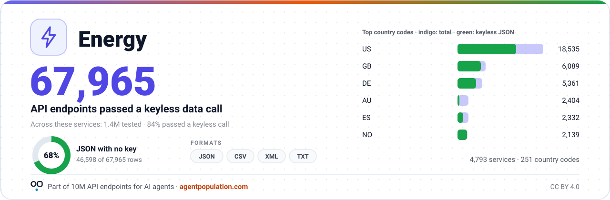
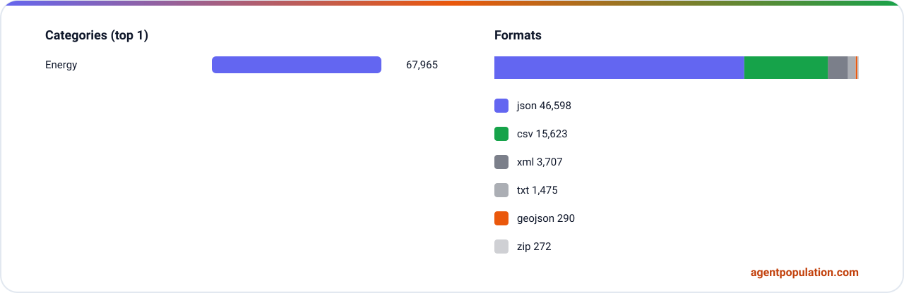

<p align="center"></p>

# ⚡ Energy API endpoints

**67,965 energy API endpoints that answered a keyless GET with a data body. For agent and app builders.**

<p align="center"><a href="#files"></a> <a href="#columns-and-tags"></a> <a href="#whats-inside"></a> <a href="#whats-inside"></a> <a href="LICENSE"></a></p>

<p align="center"><a href="#whats-in-it-for-you">What's in it</a> · <a href="#for-ai-agents">For AI agents</a> · <a href="#quick-start">Quick start</a> · <a href="#test-it-yourself">Test it yourself</a> · <a href="#files">Files</a> · <a href="#licence-and-credit">Licence</a> · <a href="#part-of-10m-api-endpoints-for-ai-agents">More packs</a></p>

This repository holds a 1,000-row sample and the services list; the full list of 67,965 endpoints is one download from the [latest release](https://github.com/agentpopulation/67k-energy-apis-for-agents/releases/latest).

**Endpoints for building an electricity, renewables or fuel tool.** Generation mix and day-ahead prices by country, grid and balancing-market data, carbon intensity, solar, wind and power-plant map layers, fuel stations and pipelines, and energy statistics, as URLs that answered with no key on their test date.

Selection rule: rows where `category is "Energy"`, less the rows that a leave-out rule drops (each counted under Known limits).

38,498 of these 67,965 rows match the focus rule (below); the others are in the pack by the selection rule only, and Known limits says what they are. 12,129 rows (17.8%) are map layers on ArcGIS Online, where anyone can publish.

## In plain words

**What is an API endpoint?** An API endpoint is one web address that a program can ask for data, for example the latest reading at one weather station. A single service, such as a national weather agency, can have thousands of endpoints: one per station, city or dataset. This pack counts endpoints, not separate services.

**What does "passed a data call" mean?** On the date shown in each row, AgentPopulation sent one plain request to that address, with no password or key, and got a non-empty data body back (JSON, CSV, XML or a file): not an error page and not an empty result. Some bodies describe a dataset rather than hold its values; see Known limits. It shows the address answered with data on that day. It is not a promise that it answers today, and licences and usage limits were not reviewed.

## What's in it for you

Four ways to use this pack. Each bucket gives a count, a filter you can apply to the CSV, one example that passed, and a list of recommended starting points with the rule that picked them. Buckets overlap; a row can fit more than one.

Examples, recommended lists and the preview are drawn from rows that match this pack's focus rule, so a row that the selection rule put in this pack but that is about something else is not shown as a starting point. Counts cover the whole bucket.

<details>
<summary>The focus rule</summary>

Focus rule: `(title matches /energ|electric|elektri|électri|elettric|eléctric|\bpower\b|solar|photovolt|\bpv\b|wind ?(farm|turbine|park|power|energy|speed)|windkraft|windpark|éolien|eolic|renewab|hydropower|hydroelectr|nuclear|natural gas|\bgas\b|\boil\b|petrol|crude|fuel|coal|grid (area|capacity|mix|emission|components|supply|management|indicators|connect)|high-voltage grid|elia grid|belgian grid|electricity grid|power grid|smart grid|through the grid|substation|transmission|pipeline|biomass|biogas|bioenerg|geotherm|district heat|heat pump|heating|charger|charging|\bev\b|batter|kwh|mwh|\bmw\b|carbon intensity|imbalance|day-ahead|\bstrom|kraftwerk|wärme|solaire|energia|lng|refiner|orphan well|oil and gas|gas wells?|oil wells?|ενέργ|ηλεκτρ|φωτοβολτ|αιολ|υδροηλεκτρ|φόρτισ/i OR subcategory matches /^(GB electricity market|Electricity generation mix|Day-ahead electricity price|Installed capacity|Grid carbon intensity|Renewable share forecast)/i) AND NOT title matches /energy intake|dietary|engine power|purchasing power|radioactivity measurements|olive oil|oil mills|oil seeds|rice oil|itinerant movements|gas phase pfas|geologic map of|eclipse|^area c\b|\baccessi\b/i AND NOT title matches /^(areal extent|point data) \(/i AND NOT url matches /request=getcapabilities/i AND NOT host is cruscotto-italia.dati.gov.it`

</details>

### 🤖 Agent tools: Grid, price, generation and carbon-intensity lookups an agent can call

**418** endpoints from 5 services · Wrap one URL pattern as a get_power_mix or get_power_price tool: pass a country, bidding zone or region, return generation by source, the price or the carbon intensity with its timestamp; add a timeout.

Start with: `tags has agent-ready AND (subcategory matches /^(GB electricity market|Electricity generation mix|Day-ahead electricity price|Installed capacity|Grid carbon intensity|Renewable share forecast)/i OR host in (api.energidataservice.dk, opendata.elia.be) OR (host is www.odwb.be AND subcategory matches /electricity/i))`

Example: [Energy-Charts day-ahead price: AT](https://api.energy-charts.info/price?bzn=AT) · Energy Charts · passed 2026-11-14

<details>
<summary>Recommended starting points: 5 services, picked by the stated criteria inside</summary>

**Recommended starting points.** Selected by stated criteria, not a ranking of quality: Services in this pack with the most endpoints that match this bucket and are tagged `agent-ready` (no key sent in the test call, JSON body, passed a data call). Ties go to the service with more country codes, then by name. Only services with at least one bucket row that matches the focus rule are listed, and the sample comes from those rows; the counts cover the whole bucket. The sample URL is the first row by URL sort after preferring, in this order: rows that match the bucket's sample preference when it has one, rows that return values rather than describe a dataset or a service (not ERDDAP /info/ pages, OGC GetCapabilities requests, bare OWS addresses, PxWeb tables, UN SDG series lists, Statistics Canada download pointers, WorldPop listings, GTFS validation reports, untitled rows or service root addresses), and agent-ready rows. Sample preference in this bucket: `url contains "api.energy-charts.info/public_power?country=de" OR title matches /generation|\bload\b|price|carbon intensity|consumption per grid area|system frequency/i`. Services named "ArcGIS organization" hold map layers from many owners and are added only when fewer than 5 other services match.

| Service (host) | Endpoints in bucket | In pack | Country codes in bucket | Formats in bucket | Sample URL that passed |
|---|---:|---:|---|---|---|
| Energy Charts (api.energy-charts.info) | 124 | 1,029 | 33 codes | json | [Energy-Charts day-ahead price: AT](https://api.energy-charts.info/price?bzn=AT) (2026-11-14) |
| Elia (opendata.elia.be) | 122 | 213 | BE | json | [Load on the Elia grid](https://opendata.elia.be/api/explore/v2.1/catalog/datasets/ods003/exports/jsonl) (2026-11-14) |
| Elexon (data.elexon.co.uk) | 99 | 894 | GB | json | [Elexon BMRS: 2 to 14 days ahead generat…](https://data.elexon.co.uk/bmrs/api/v1/datasets/FOU2T14D) (2026-11-14) |
| Datavejviser - Guide to Public Data (api.energidataservice.dk) | 56 | 95 | DK | json | [Consumption per Grid Area](https://api.energidataservice.dk/dataset/ConsumptionGridAreaHour) (2026-11-14) |
| Carbonintensity (api.carbonintensity.org.uk) | 17 | 997 | GB | json | [UK carbon intensity region 1](https://api.carbonintensity.org.uk/regional/regionid/1) (2026-11-14) |

</details>

### 📱 App features: Power-plant, solar, wind, charging and fuel-station maps

**6,803** endpoints from 1,748 services · Show power plants, solar and wind sites, substations, chargers or fuel stations near a place on a map; each layer query returns features with names, capacities or fuel types.

4,059 of these are map-layer queries that asked for a few records (`resultRecordCount`); raise it or page through for the whole layer.

Start with: `subcategory matches /power plants|solar|wind|substations|transmission lines|pipelines|fuel stations|charging/i OR format is geojson`

Example: [Sheffield Solar, University of Sheffield: PV\_Live…](https://api.solar.sheffield.ac.uk/pvlive/api/v4/gsp_list) · Sheffield · passed 2026-11-15

<details>
<summary>Recommended starting points: 8 services, picked by the stated criteria inside</summary>

**Recommended starting points.** Selected by stated criteria, not a ranking of quality: Services in this pack with the most endpoints that match this bucket and passed a data call. Ties go to the service with more country codes, then by name. Only services with at least one bucket row that matches the focus rule are listed, and the sample comes from those rows; the counts cover the whole bucket. The sample URL is the first row by URL sort after preferring, in this order: rows that match the bucket's sample preference when it has one, rows that return values rather than describe a dataset or a service (not ERDDAP /info/ pages, OGC GetCapabilities requests, bare OWS addresses, PxWeb tables, UN SDG series lists, Statistics Canada download pointers, WorldPop listings, GTFS validation reports, untitled rows or service root addresses), and agent-ready rows. Sample preference in this bucket: `NOT url matches ///(services[0-9]*(-[a-z0-9]+)?|utility)\.arcgis\.com//i AND title matches /power plant|solar|wind|charg|fuel station|substation|transmission/i`. Services named "ArcGIS organization" hold map layers from many owners and are added only when fewer than 5 other services match.

| Service (host) | Endpoints in bucket | In pack | Country codes in bucket | Formats in bucket | Sample URL that passed |
|---|---:|---:|---|---|---|
| Sheffield (api.solar.sheffield.ac.uk) | 1,000 | 1,000 | GB | json | [Sheffield Solar, University of Sheffiel…](https://api.solar.sheffield.ac.uk/pvlive/api/v4/gsp_list) (2026-11-15) |
| Globalsolaratlas (api.globalsolaratlas.info) | 999 | 999 | 134 codes | json | [Global Solar Atlas (World Bank / ESMAP,…](https://api.globalsolaratlas.info/data/lta?loc=-0.0319,109.3250) (2026-11-15) |
| Sahkotin (api.sahkotin.fi) | 106 | 106 | FI | json | [Sähkötin: Finnish spot electricity pric…](https://api.sahkotin.fi/prices?start=2018-01-01T00:00:00Z&end=2018-02-01T00:00:00Z) (2026-11-15) |
| U.S. EPA (ArcGIS Online) (services.arcgis.com) | 35 | 57 | US | json | [Benefits of Completed Renewable Energy …](https://services.arcgis.com/cJ9YHowT8TU7DUyn/arcgis/rest/services/Benefits_of_Completed_Renewable_Energy_Projects/FeatureServer/0/query?where=1%3D1&outFields=*&returnGeometry=false&resultRecordCount=5&f=json) (2026-11-14) |
| Greece National Data Portal (geo.rae.gr) | 34 | 107 | GR | geojson, xml | [Ηλιοθερμικοί Σταθμοί - Λήψη KML - rae\_s…](https://geo.rae.gr/geoserver/wfs?service=WFS&version=2.0.0&request=GetFeature&typeNames=rae_status%3AV_SDI_R_SOLAR_ALL&outputFormat=KML) (2026-11-15) |
| GREATER LONDON AUTHORITY (ArcGIS Online) (services.arcgis.com) | 28 | 54 | GB, US | json | [Buildings: Future Demand: Electricity (…](https://services.arcgis.com/drifeOPKLpgnJ8Qa/arcgis/rest/services/Buildings_Electricity_%28Small_Power%29_Demand_with_Deep_Retrofit/FeatureServer/0/query?where=1%3D1&outFields=*&returnGeometry=false&resultRecordCount=5&f=json) (2026-11-14) |
| Utah DNR Online Maps (ArcGIS Online) (services.arcgis.com) | 26 | 41 | US | json | [5\_11a\_Electricity\_Generation\_Electricity](https://services.arcgis.com/ZzrwjTRez6FJiOq4/arcgis/rest/services/5_11a_Electricity_Generation_Electricity/FeatureServer/0/query?where=1%3D1&outFields=*&returnGeometry=false&resultRecordCount=5&f=json) (2026-11-14) |
| BrisMAP Public (ArcGIS Online) (services2.arcgis.com) | 24 | 26 | AU, US | json | [City Plan 2014 - Regional infrastructur…](https://services2.arcgis.com/dEKgZETqwmDAh1rP/arcgis/rest/services/Regional_infrastructure_corridors_and_substations_overlay_Petroleum_pipelines/FeatureServer/0/query?where=1%3D1&outFields=*&returnGeometry=false&resultRecordCount=5&f=json) (2026-11-14) |

</details>

### 🧠 Grounding and data pipelines: Energy statistics, market series and country charts for scheduled loads

**23,784** endpoints from 701 services · Load energy balances, generation, consumption and price series on a schedule into your own store, so answers about a country's energy cite a dated source.

Start with: `tags has statistics OR format in (csv, xml, zip, txt)`

Example: [Our World in Data: electricity generation - Aruba](https://ourworldindata.org/grapher/electricity-generation.csv?v=1&csvType=filtered&useColumnShortNames=true&country=~ABW) · Our World in Data · passed 2026-11-14

<details>
<summary>Recommended starting points: 8 services, picked by the stated criteria inside</summary>

**Recommended starting points.** Selected by stated criteria, not a ranking of quality: Services in this pack with the most endpoints that match this bucket and passed a data call. Ties go to the service with more country codes, then by name. Only services with at least one bucket row that matches the focus rule are listed, and the sample comes from those rows; the counts cover the whole bucket. The sample URL is the first row by URL sort after preferring, in this order: rows that match the bucket's sample preference when it has one, rows that return values rather than describe a dataset or a service (not ERDDAP /info/ pages, OGC GetCapabilities requests, bare OWS addresses, PxWeb tables, UN SDG series lists, Statistics Canada download pointers, WorldPop listings, GTFS validation reports, untitled rows or service root addresses), and agent-ready rows. Sample preference in this bucket: `NOT url matches ///(services[0-9]*(-[a-z0-9]+)?|utility)\.arcgis\.com//i AND title matches /electricity|energy balance|renewab|generation|natural gas|crude|petroleum|energy consumption/i`. Services named "ArcGIS organization" hold map layers from many owners and are added only when fewer than 5 other services match.

| Service (host) | Endpoints in bucket | In pack | Country codes in bucket | Formats in bucket | Sample URL that passed |
|---|---:|---:|---|---|---|
| Our World in Data (ourworldindata.org) | 1,168 | 1,168 | 190 codes | csv | [Our World in Data: electricity generati…](https://ourworldindata.org/grapher/electricity-generation.csv?v=1&csvType=filtered&useColumnShortNames=true&country=~ABW) (2026-11-14) |
| Spp (portal.spp.org) | 1,000 | 1,000 | US | csv | [Southwest Power Pool (SPP): SPP Portal …](https://portal.spp.org/file-browser-api/download/da-mcp?path=/2025/01/DA-MCP-202501010100.csv) (2026-11-15) |
| Omie (www.omie.es) | 997 | 997 | ES | csv | [OMIE (Iberian electricity market operat…](https://www.omie.es/es/file-download?parents%5B0%5D=marginalpdbc&filename=marginalpdbc_20230101.1) (2026-11-15) |
| www.emi.ea.govt.nz | 990 | 990 | NZ | csv | [Electricity Authority Te Mana Hiko (EMI…](https://www.emi.ea.govt.nz/Environment/Datasets/HydrologicalModellingDataset/1_InfrastructureAndHydroConstraintAttributes/20241231_InfrastructureAndHydroConstraintAttributes.csv) (2026-11-15) |
| Aemo (data.wa.aemo.com.au) | 989 | 989 | AU | csv | [AEMO (Wholesale Electricity Market, WA)…](https://data.wa.aemo.com.au/public/public-data/datafiles/commissioning-test/commissioning-test-summary-2014.csv) (2026-11-15) |
| Aemo (www.aemo.com.au) | 989 | 989 | AU | csv | [AEMO (Australian Energy Market Operator…](https://www.aemo.com.au/aemo/data/nem/priceanddemand/PRICE_AND_DEMAND_199812_NSW1.csv) (2026-11-15) |
| Sem O (reports.sem-o.com) | 982 | 983 | IE | csv, xml, json | [SEMO (Single Electricity Market Operato…](https://reports.sem-o.com/documents/IDC_Statistic_20191117103003.csv) (2026-11-15) |
| Statistics Norway PxWeb (data.ssb.no) | 929 | 929 | NO | json | [Norway statistics: 05488: Estimated ann…](https://data.ssb.no/api/v0/en/table/al/al05/lonnansatt/SBMENU12027/SBMENU12048/BeregnKraft) (2026-11-15) |

</details>

### 🧪 Evals and testing: Grid data, map layers and statistics files to test an energy tool

**67,965** endpoints · 4,793 services · 251 country codes · 6 formats · Run your energy tool against a fixed set of URLs across formats; check that units (MW, MWh, price per MWh, gCO2/kWh), timestamps and country codes parse, and keep last_tested as the baseline for your own re-tests.

Start with: the whole pack

Example: [Our World in Data: electricity generation - Aruba](https://ourworldindata.org/grapher/electricity-generation.csv?v=1&csvType=filtered&useColumnShortNames=true&country=~ABW) · Our World in Data · passed 2026-11-14

<details>
<summary>Recommended starting points: 8 services, picked by the stated criteria inside</summary>

**Recommended starting points.** Selected by stated criteria, not a ranking of quality: Services in this pack that returned the most different formats, then the most endpoints that passed a data call, then by name: a mix of response shapes to test parsers and tool calls. Only services with at least one bucket row that matches the focus rule are listed, and the sample comes from those rows; the counts cover the whole bucket. The sample URL is the first row by URL sort after preferring, in this order: rows that match the bucket's sample preference when it has one, rows that return values rather than describe a dataset or a service (not ERDDAP /info/ pages, OGC GetCapabilities requests, bare OWS addresses, PxWeb tables, UN SDG series lists, Statistics Canada download pointers, WorldPop listings, GTFS validation reports, untitled rows or service root addresses), and agent-ready rows. Sample preference in this bucket: `NOT url matches ///(services[0-9]*(-[a-z0-9]+)?|utility)\.arcgis\.com//i`. Services named "ArcGIS organization" hold map layers from many owners and are added only when fewer than 5 other services match.

| Service (host) | Endpoints in bucket | In pack | Country codes in bucket | Formats in bucket | Sample URL that passed |
|---|---:|---:|---|---|---|
| Elia (opendata.elia.be) | 213 | 213 | BE | json, csv, xml, txt, zip | [Load on the Elia grid](https://opendata.elia.be/api/explore/v2.1/catalog/datasets/ods003/exports/jsonl) (2026-11-14) |
| ArcGIS Online: ACE Irreplaceability (Rank 4 & 5) - KML (cecgis-caenergy.opendata.arcgis.com) | 123 | 123 | US | json, csv, zip, xml, geojson | [Electric Load Serving Entities (Other) …](https://cecgis-caenergy.opendata.arcgis.com/api/download/v1/items/07224640a2fe42f89399be796e7b8810/geojson?layers=0) (2026-11-15) |
| daten.stadt.sg.ch | 50 | 50 | CH | json, csv, xml, txt, geojson | [Current electricity production of the s…](https://daten.stadt.sg.ch/api/v2/catalog/datasets/aktuelle-stromproduktion-der-solaranlagen-der-stgaller-stadtwerke/exports/jsonld) (2026-11-14) |
| Canadian Urban Data Catalogue (CUDC) (geohub.saskatchewan.ca) | 36 | 36 | CA | csv, geojson, xml, json, zip | [Oil and Gas Pools - GeoJSON](https://geohub.saskatchewan.ca/api/download/v1/items/ae2640f3ecf64e69a317d25cece224d2/geojson?layers=4) (2026-11-15) |
| ArcGIS Online: BLM AZ Administrative Unit Office Locations (Point) (gbp-blm-egis.hub.arcgis.com) | 26 | 26 | US | json, csv, xml, zip, geojson | [BLM CO Oil and Gas Potential - GeoJSON](https://gbp-blm-egis.hub.arcgis.com/api/download/v1/items/02ec35c531df416e8722a377f09e862a/geojson?layers=0) (2026-11-15) |
| Puglia (dati.puglia.it) | 25 | 25 | IT | json, csv, xml, geojson, txt | [Energy Efficiency Fund](https://dati.puglia.it/ckan/dataset/58f7f999-94d8-444f-bfa9-3a675d44c026/resource/199d2ab0-c2ef-4d92-b9bc-9d4804bfceda/download/fondo-efficientamento-energetico-2025-foglio1.csv) (2026-11-14) |
| California Natural Resources Agency Open (gis.data.cnra.ca.gov) | 22 | 22 | US | csv, json, xml, zip, geojson | [Oil and Gas Field Administrative Bounda…](https://gis.data.cnra.ca.gov/api/download/v1/items/a1e2df6a8bdc4ed7bfdfb894c1a3f285/geojson?layers=0) (2026-11-15) |
| ArcGIS Online: ACT Canopy Cover 2020 1m WESTON (actmapi-actgov.opendata.arcgis.com) | 11 | 11 | AU | csv, zip, geojson, json, xml | [ACT Canopy Cover 2020 1m STROMLO - CSV](https://actmapi-actgov.opendata.arcgis.com/api/download/v1/items/2f277dfd24964ef3943d99b34c38ebad/csv?layers=14) (2026-11-15) |

</details>

The same lists are in [recommended.json](recommended.json), ready for an agent to load.

## Questions an agent can answer with this pack

- What is the current electricity generation mix of a European country? Try [Energy-Charts public power: Germany](https://api.energy-charts.info/public_power?country=de) (Energy Charts, passed 2026-11-14).
- What is the day-ahead electricity price in a European bidding zone? Try [Energy-Charts day-ahead price: DE-LU](https://api.energy-charts.info/price?bzn=DE-LU) (Energy Charts, passed 2026-11-14).
- How carbon-intensive is electricity in a UK region? Try [UK carbon intensity region 1](https://api.carbonintensity.org.uk/regional/regionid/1) (Carbonintensity, passed 2026-11-14).
- What share of a country's electricity comes from renewables? Try [Our World in Data: share electricity renewables -…](https://ourworldindata.org/grapher/share-electricity-renewables.csv?v=1&csvType=filtered&useColumnShortNames=true&country=~AFG) (Our World in Data, passed 2026-11-14).

## What "passed a data call" means

> [!NOTE]
> On the date in `last_tested` (IST), one GET to the URL, sent with no key, returned HTTP 2xx and a non-empty data body. HTML pages and empty results did not pass. The `format` column records what came back. This is a test result for that date, not a promise that the URL answers today. Licences, terms, rate limits, accuracy and freshness were not reviewed. Endpoints are URLs, not separate APIs; many share one service. This pack was tested 14–15 Nov 2026; snapshot 15 Nov 2026.

## For AI agents

Start from keyless JSON endpoints (`agent-ready`). The code below loads `recommended.json` and calls the first recommended service in the Agent tools bucket, with a timeout (`node examples/agent-start.mjs --recommended`). With no argument, `node examples/agent-start.mjs` calls the most recently tested agent-ready row of the sample; pass a `.csv` or `.csv.gz` path to use that file instead. See [examples/agent-start.mjs](examples/agent-start.mjs).

```js
// Node 18+. Loads recommended.json (the local copy, or the raw file on GitHub) and calls one keyless JSON endpoint.
import fs from 'node:fs';

const RAW = 'https://raw.githubusercontent.com/agentpopulation/67k-energy-apis-for-agents/main/recommended.json';
const rec = fs.existsSync('recommended.json')
  ? JSON.parse(fs.readFileSync('recommended.json', 'utf8'))
  : await (await fetch(RAW)).json();

const pick = rec.buckets.find((b) => b.id === 'agent').services[0];
try {
  const res = await fetch(pick.sample_url, {
    headers: { 'User-Agent': 'agent-example/1.0' },
    signal: AbortSignal.timeout(15000),
  });
  console.log(pick.service, res.status, res.headers.get('content-type'));
  console.log((await res.text()).slice(0, 300));
} catch (err) {
  console.log(`did not answer now; last passed ${pick.sample_last_tested} (${err.message})`);
}
```

How an agent picks an endpoint:

1. Filter to `agent-ready` and your country or topic.
2. Prefer the newest `last_tested` and the larger services.
3. Call with a timeout and check the body before you use it.

## Quick start

The examples run against the sample in `data/` out of the box (1,000 rows). Each takes an optional path to a `.csv` or `.csv.gz` file instead.

```bash
git clone https://github.com/agentpopulation/67k-energy-apis-for-agents.git
cd 67k-energy-apis-for-agents
python examples/quickstart.py
node examples/quickstart.mjs
node examples/agent-start.mjs
```

Full list: download `Energy_API_Endpoints_AgentPopulation_Snapshot_2026-11-15.csv.gz` (67,965 rows, 2.3 MB) from [releases/latest](https://github.com/agentpopulation/67k-energy-apis-for-agents/releases/latest), then gunzip it and pass its path. The scripts also read the `.csv.gz` as it is.

```bash
gunzip Energy_API_Endpoints_AgentPopulation_Snapshot_2026-11-15.csv.gz
python examples/quickstart.py Energy_API_Endpoints_AgentPopulation_Snapshot_2026-11-15.csv
node examples/quickstart.mjs Energy_API_Endpoints_AgentPopulation_Snapshot_2026-11-15.csv
```

### curl

Quote the URL: some contain commas.

```bash
curl -sL "https://raw.githubusercontent.com/agentpopulation/67k-energy-apis-for-agents/main/data/Energy_API_Endpoints_AgentPopulation_Sample.csv" | head -n 4
curl -s --max-time 15 "https://api.energy-charts.info/price?bzn=AT" | head -c 600
```

### Python

Standard library only: [examples/quickstart.py](examples/quickstart.py) reads the sample, or the path you pass, keeps agent-ready rows and calls the most recently tested one.

<details>
<summary>The code</summary>

```python
# Python 3, standard library only. Run from a clone of this repository:
#   python examples/quickstart.py [path]
# With no path it reads the sample in data/. Pass the full list from the latest release (.csv or .csv.gz) instead.
# Keeps agent-ready rows and calls the most recently tested one.
import csv
import gzip
import os
import re
import sys
import urllib.request

HERE = os.path.dirname(os.path.abspath(__file__))
path = sys.argv[1] if len(sys.argv) > 1 else os.path.join(HERE, "..", "data", "Energy_API_Endpoints_AgentPopulation_Sample.csv")
opener = gzip.open if path.endswith(".gz") else open
with opener(path, "rt", newline="", encoding="utf-8") as f:
    rows = list(csv.DictReader(f))

agent = [r for r in rows if "agent-ready" in r["tags"].split("|")]
# Newest test date first; URLs that describe a dataset or a service rather than return values go last.
DESCRIBES = re.compile(r"/erddap/info/|action-report\.json$|[?&]request=getcapabilities|/GeoArea/[^/?]+/List|getFullTableDownloadCSV|hub\.worldpop\.org", re.I)
agent.sort(key=lambda r: r["last_tested"], reverse=True)
agent.sort(key=lambda r: 1 if DESCRIBES.search(r["url"]) else 0)
print(len(rows), "rows,", len(agent), "agent-ready")
if not agent:
    sys.exit(0)

row = agent[0]
req = urllib.request.Request(row["url"], headers={"User-Agent": "agent-example/1.0"})
try:
    with urllib.request.urlopen(req, timeout=15) as res:
        body = res.read(1_000_000).decode("utf-8", "replace")
        print(res.status, res.headers.get("Content-Type"))
        print(body[:300])
except Exception as err:
    print(f"did not answer now; last passed {row['last_tested']} ({err})")
```

</details>

### JavaScript

Reads the sample as JSON because the CSV has quoted commas.

<details>
<summary>The code</summary>

```js
// Node 18+. Reads the sample as JSON (the CSV has quoted commas), local file first.
import fs from 'node:fs';

const FILE = 'data/Energy_API_Endpoints_AgentPopulation_Sample.json';
const rows = fs.existsSync(FILE)
  ? JSON.parse(fs.readFileSync(FILE, 'utf8'))
  : await (await fetch('https://raw.githubusercontent.com/agentpopulation/67k-energy-apis-for-agents/main/data/Energy_API_Endpoints_AgentPopulation_Sample.json')).json();

const row = rows.find((r) => r.tags.includes('agent-ready'));
const res = await fetch(row.url, { headers: { 'User-Agent': 'agent-example/1.0' }, signal: AbortSignal.timeout(15000) });
console.log(res.status, (await res.text()).slice(0, 300));
```

</details>

### Agent tools

[examples/agent-tools.json](examples/agent-tools.json) holds two tool definitions in the shape most tool-calling APIs accept (name, description, JSON Schema); rename `parameters` if yours uses another key. [examples/quickstart.mjs](examples/quickstart.mjs) implements them:

- `find_endpoints` searches the agent-ready rows of the list by words, country code (their format is json). When you load the tools of more than one pack, prefix the names (for example `energy_find_endpoints`) so they do not clash.
- `fetch_endpoint` calls one URL, **refuses any URL that is not in the list** and does not follow redirects. The allowlist is built from the CSV, so a URL injected into a prompt is refused.

The same two tools can sit behind an MCP server.

## Test it yourself

Re-test endpoints from the sample with the same rule: HTTP 2xx and a non-empty body that is not an HTML page. Node 18+, no packages.

```bash
node tools/test-endpoints.mjs
```

It tests the first 50 URLs and prints one line: tested, passed, did not pass. Options: a `.csv` or `.csv.gz` path (the full list from the release), `--limit 50`, `--timeout-ms 10000`, `--out results.csv`. The results file holds `url`, `status`, `passed`, `content_type`, `ms` and `checked_at`; a status of `timeout` or `error:<code>` means no HTTP answer came back. It is polite: GET only, no key sent, at most 4 requests in flight, one at a time per listed host, at least 1 second between requests to one listed host, and reading stops once 256 kB of a body is kept. Redirects are followed and may lead to another host. `results.csv` is in `.gitignore`.

## Preview

One row from each of the five largest services among rows that match the focus rule, services with rows that return values first.

| Title | Service | Country | Format | Tested | Link |
|---|---|---|---|---|---|
| Our World in Data: electricity generation - Aruba | Our World in Data | AW | csv | 2026-11-14 | [ourworldindata.org](https://ourworldindata.org/grapher/electricity-generation.csv?v=1&csvType=filtered&useColumnShortNames=true&country=~ABW) |
| Fraunhofer ISE (Energy-Charts): Energy-Charts API | Energy Charts | AT | json | 2026-11-15 | [api.energy-charts.info](https://api.energy-charts.info/cbet?country=at&start=2015-01-01&end=2015-01-31) |
| Octopus Energy: Octopus Energy public products API | Octopus | GB | json | 2026-11-15 | [api.octopus.energy](https://api.octopus.energy/v1/products/) |
| PSE S.A. (Polskie Sieci Elektroenergetyczne): PSE market an… | Pse | PL | json | 2026-11-15 | [api.raporty.pse.pl](https://api.raporty.pse.pl/api/it-omb-rbb?$filter=business_date%20eq%20'2025-11-15') |
| Sheffield Solar, University of Sheffield: PV\_Live API v4 | Sheffield | GB | json | 2026-11-15 | [api.solar.sheffield.ac.uk](https://api.solar.sheffield.ac.uk/pvlive/api/v4/gsp_list) |

Browse the 1,000-row sample: [Sample CSV](data/Energy_API_Endpoints_AgentPopulation_Sample.csv) · [Sample JSON](data/Energy_API_Endpoints_AgentPopulation_Sample.json).

## What's inside

<p align="center"></p>

<details>
<summary>Country codes: 251</summary>

| Code | Country | Endpoints | |
|---|---|---:|---|
| US | United States | 18,535 | `████████████████████` |
| GB | United Kingdom | 6,089 | `██████▋` |
| DE | Germany | 5,361 | `█████▊` |
| AU | Australia | 2,404 | `██▋` |
| ES | Spain | 2,332 | `██▌` |
| NO | Norway | 2,139 | `██▎` |
| CA | Canada | 2,092 | `██▎` |
| AR | Argentina | 1,902 | `██` |
| IE | Ireland | 1,768 | `█▉` |
| NL | Netherlands | 1,749 | `█▉` |
| | other 241 codes | 21,653 | |
| | global or unknown | 1,941 | `██▏` |

</details>

<details>
<summary>Categories: top 1</summary>

| Category | Endpoints | |
|---|---:|---|
| Energy | 67,965 | `████████████████████` |

</details>

Formats: json 46,598 · csv 15,623 · xml 3,707 · txt 1,475 · geojson 290 · zip 272

<details>
<summary>Largest services: top 25 of 4,793</summary>

| Service | Host | Endpoints | Keyless JSON | |
|---|---|---:|---:|---|
| Our World in Data | ourworldindata.org | 1,168 | 0 | `████████████████████` |
| Energy Charts | api.energy-charts.info | 1,029 | 1,029 | `█████████████████▋` |
| Api Couleur Tempo † | www.api-couleur-tempo.fr | 1,000 | 1,000 | `█████████████████▏` |
| Caiso † | www.caiso.com | 1,000 | 0 | `█████████████████▏` |
| Octopus | api.octopus.energy | 1,000 | 1,000 | `█████████████████▏` |
| Pse | api.raporty.pse.pl | 1,000 | 1,000 | `█████████████████▏` |
| S3 (AWS) † | ons-aws-prod-opendata.s3.amazonaws.com | 1,000 | 4 | `█████████████████▏` |
| Sheffield | api.solar.sheffield.ac.uk | 1,000 | 1,000 | `█████████████████▏` |
| Spp | portal.spp.org | 1,000 | 0 | `█████████████████▏` |
| Svk † | mimer.svk.se | 1,000 | 0 | `█████████████████▏` |
| Globalsolaratlas | api.globalsolaratlas.info | 999 | 999 | `█████████████████▏` |
| Elhub | api.elhub.no | 999 | 999 | `█████████████████▏` |
| Energyzero | api.energyzero.nl | 999 | 999 | `█████████████████▏` |
| Ote Cr | www.ote-cr.cz | 999 | 999 | `█████████████████▏` |
| Elering † | dashboard.elering.ee | 998 | 894 | `█████████████████▏` |
| Smard † | www.smard.de | 998 | 998 | `█████████████████▏` |
| Awattar † | api.awattar.at | 997 | 997 | `█████████████████▏` |
| Carbonintensity | api.carbonintensity.org.uk | 997 | 997 | `█████████████████▏` |
| Okte † | isot.okte.sk | 997 | 997 | `█████████████████▏` |
| Omie | www.omie.es | 997 | 0 | `█████████████████▏` |
| Awattar † | api.awattar.de | 996 | 996 | `█████████████████` |
| www.emi.ea.govt.nz | www.emi.ea.govt.nz | 990 | 0 | `█████████████████` |
| Aemo | data.wa.aemo.com.au | 989 | 0 | `████████████████▉` |
| Aemo | www.aemo.com.au | 989 | 0 | `████████████████▉` |
| Sem O | reports.sem-o.com | 983 | 2 | `████████████████▉` |

† No row of these services matches the focus rule: the selection rule put them in this pack, so they are not used as a starting point.

</details>

<details>
<summary>Rows per test date: 14–15 Nov 2026</summary>

| Date (IST) | Endpoints | |
|---|---:|---|
| 2026-11-15 | 55,604 | `████████████████████` |
| 2026-11-14 | 12,361 | `████▌` |

</details>

## Files

| File | Rows | Size | Use |
|---|---:|---:|---|
| [data/Energy_API_Services_AgentPopulation.csv](data/Energy_API_Services_AgentPopulation.csv) | 4,793 | 280.2 kB | One row per service with its endpoint count in this pack |
| [data/Energy_API_Endpoints_AgentPopulation_Sample.csv](data/Energy_API_Endpoints_AgentPopulation_Sample.csv) | 1,000 | 287.3 kB | The sample: focus-rule rows first, each service in proportion to its share; ArcGIS Online layers count as one service |
| [data/Energy_API_Endpoints_AgentPopulation_Sample.json](data/Energy_API_Endpoints_AgentPopulation_Sample.json) | 1,000 | 478.4 kB | The same rows as JSON, tags as an array |
| [Energy_API_Endpoints_AgentPopulation_Snapshot_2026-11-15.csv.gz](https://github.com/agentpopulation/67k-energy-apis-for-agents/releases/latest) | 67,965 | 2.3 MB | The full list, gzipped CSV: a download from the latest release, checked by `SHA256SUMS.txt` |
| [tools/test-endpoints.mjs](tools/test-endpoints.mjs) | | | Re-tests endpoints from the sample or the full list |

Sample size: 1,000 rows, which is 1,000 or one third of the pack rounded down, whichever is smaller. Rows that match the focus rule come first. Each service gets rows in proportion to its share of those rows, at least one for the largest services and at most 50% of the sample while other services have rows; ArcGIS Online layers count as one service, whatever their organisation. Within a service, agent-ready rows, rows that return values and the newest test dates come first, and rows are written in turn across services. Service root addresses are placed at the end of the sample.

Full list: download `Energy_API_Endpoints_AgentPopulation_Snapshot_2026-11-15.csv.gz` (67,965 rows, 2.3 MB) from [releases/latest](https://github.com/agentpopulation/67k-energy-apis-for-agents/releases/latest), then gunzip it and pass its path. The scripts also read the `.csv.gz` as it is.

Excel users: Data > From Text/CSV, UTF-8. Files are UTF-8 without a byte-order mark and comma-separated.

## Columns and tags

<details>
<summary>Columns, types and tags</summary>

| Column | Type | Example | Meaning |
|---|---|---|---|
| url | string | [https://ourworldindata.org/grapher/elec…](https://ourworldindata.org/grapher/electricity-generation.csv?v=1&csvType=filtered&useColumnShortNames=true&country=~ABW) | The address that was tested |
| title | string | Our World in Data: electricity generati… | Station, dataset or feed name |
| service | string | Our World in Data | The service the endpoint belongs to; joins to the services file together with host |
| host | string | ourworldindata.org | Host name of the address |
| country | string | AW | ISO 3166-1 alpha-2 code, or EU; empty when global or unknown |
| category | string | Energy | Category of the endpoint |
| subcategory | string |  | Left empty from the 15 Nov 2026 snapshot; kept so the columns stay the same |
| format | string | csv | What the test call returned: json, csv, geojson, xml, gtfs, zip, txt and so on |
| tags | string | `energy\|no-key\|csv` | Tags separated by \| |
| last_tested | date | 2026-11-14 | Date of the test call, YYYY-MM-DD (IST) |

| Tag | Rows | Meaning |
|---|---:|---|
| energy | 67,965 | Topic tag |
| no-key | 67,965 | No key was sent in the test call |
| agent-ready | 46,598 | No key sent, JSON body, passed a data call on last_tested |
| json | 46,598 | Format of the body |
| maps | 18,859 | Topic tag |
| csv | 15,623 | Format of the body |
| open-data | 8,869 | Topic tag |
| statistics | 3,829 | Topic tag |
| xml | 3,707 | Format of the body |
| government | 3,657 | Topic tag |
| weather | 2,519 | Topic tag |
| environment | 1,160 | Topic tag |
| finance | 1,117 | Topic tag |
| forecast | 1,023 | Topic tag |
| climate | 474 | Topic tag |
| mcp-server | 320 | Topic tag |
| economy | 304 | Topic tag |
| geojson | 290 | Format of the body |
| science | 237 | Topic tag |
| elevation | 227 | Topic tag |
| health | 150 | Topic tag |
| transit | 116 | Topic tag |
| air-quality | 115 | Topic tag |
| rivers | 105 | Topic tag |
| oceans | 64 | Topic tag |
| aviation | 25 | Topic tag |
| floods | 22 | Topic tag |
| geocoding | 16 | Topic tag |
| traffic | 15 | Topic tag |
| maritime | 6 | Topic tag |
| ai-ml | 3 | Topic tag |
| hazards | 3 | Topic tag |
| earthquakes | 1 | Topic tag |
| embeddings | 1 | Topic tag |
| groundwater | 1 | Topic tag |
| gtfs | 1 | GTFS feed |
| wildfire | 1 | Topic tag |

A machine-readable copy of this dictionary is in [datapackage.json](datapackage.json).

</details>

## Known limits

- 27.3% of rows carry country code US; 1,941 rows have no code (global or unknown).
- 1,900 rows come from PxWeb or Statistics Canada services. Some statistics endpoints return metadata or a pointer on GET; the table may need a second request or a POST.
- 16,837 rows are map-layer queries with resultRecordCount set: the tested call asked for a few records; change the query to get the full layer.
- 799 rows carry limit=1: the tested call asked for one record; raise the limit or page through.
- 1 rows are open-data portal dataset records, which may return a dataset record with links rather than the table itself.
- 1,747 rows are files (zip 272, txt 1,475) rather than bodies an agent reads directly.
- 1 row is a service root address (the host alone or an API or version path such as /v1, with no query), which may describe the service rather than return data; the sample, examples and recommended lists use other rows first.
- 12,129 rows are layers on ArcGIS Online, where anyone can publish: some are class projects, tests or copies. Check the owner and the fields before you rely on one.
- 28,759 rows sit in the energy category but have no energy, power, fuel or grid term in the title (many are map layers with short or coded names). Check the title before you use one; they are not used as starting points.
- 313 rows are Italian municipal open-data files (census, property values, schools, weather, a few fuel and electricity prices); most are not about energy, and none is used as a starting point.
- 193 rows use energy, power, oil or gas in another sense (food energy, food radioactivity, engine power, purchasing power, aircraft engines, solar eclipses, and entries to Milan's AREA C traffic zone by vehicle power supply).
- 290 rows are subsurface formation layers (zone tops, bases and areal extents): geology for oil and gas, not energy figures.
- 702 rows are WMS or WFS capability documents (`request=GetCapabilities`): they list the layers of a map service; a second request returns the features.
- 141 rows from Canadian (.ca) or New Zealand (.nz) hosts carry country code US or GB in this snapshot; filter by host when you need one of those countries.
- 1,168 rows are Our World in Data charts filtered to one country; the same chart repeats per country, so change `country=` in the URL instead of collecting each row.
- Stations and feeds can go quiet after their test date; re-test a URL before you rely on it.
- Not in this pack: endpoints that need a key or a POST, and URLs that did not pass.
- Left out: 635 rows whose URL carried a credential-looking parameter or a login.
- Left out: 2 rows with an email-like address.
- Left out: 399 ArcGIS Survey123 layers (they can hold people's form answers).
- Left out: 3 layers marked editable in the title (they can hold entries that people added).
- Left out: 50 ArcGIS layers that keep a form's default service name (they can hold people's form answers).
- Left out: 352 ArcGIS class or coursework layers (lab, assignment, exam, quiz, lesson, exercise, tutorial and final-project layers, copies of class layers, layers named for a person or a person's home, and layers whose name ends in a person's name or holds a student number).
- Left out: 14 ArcGIS layers that hold reports, comments, submissions or form responses sent in by the public.
- Left out: 5 ArcGIS layers that are records about named people (employee, patient, client or donor lists, home addresses, voter lists, sex offender and missing person layers).
- Left out: 1 row that is another address of an ArcGIS layer dropped for what it holds (one of the reasons above, found under another address of the layer).
- Left out: 83 rows of ArcGIS Online organisations that are class accounts (25 layers or more, at least 50% of them class or coursework layers): their other layers are students' work too.
- Left out: 1,497 rows of ArcGIS Online organisations that are class accounts (3 class sets or more in at least 20% of their rows, 10 class sets or more with no organisation name, or layers signed by students read by hand): their other layers are students' work too.
- Left out: 268 rows of class sets: one map layer saved under 5 or more students' initials or names in one ArcGIS Online organisation, or in 4 or more students' own organisations.
- Left out: 3,190 rows of the ArcGIS Online organisations of universities, colleges and schools (many of their layers are students' work).
- Left out: 39 rows that repeat an address already in the pack.
- Left out: 43 rows whose title is about COVID-19 or vaccination (map layers filed under energy, not about energy).

## Licence and credit

> [!IMPORTANT]
> This list (URLs, titles, tags and test results) is © 2026 AgentPopulation, released under [CC BY 4.0](https://creativecommons.org/licenses/by/4.0/). Credit AgentPopulation and link agentpopulation.com. The data each endpoint returns belongs to its provider and stays under that provider's terms; this licence does not cover it.

Copy-ready credit:

`Energy API endpoints by AgentPopulation (https://agentpopulation.com), CC BY 4.0, snapshot 15 Nov 2026.`

GitHub's "Cite this repository" button reads [CITATION.cff](CITATION.cff).

<!-- agentpopulation:start -->
## Part of 10M API endpoints for AI agents

This pack is one of the 50 topic packs of [10m-open-apis-for-ai-agents](https://github.com/agentpopulation/10m-open-apis-for-ai-agents), the open collection by [AgentPopulation](https://agentpopulation.com). Target: 10 million+ open API endpoints that pass a keyless API call.

AgentPopulation has tested over 5 million API endpoints: 5,129,834 tested, 3,726,509 passed a data call (snapshot 15 Nov 2026). This is the energy pack: 67,965 endpoints from 4,793 services. Packs overlap, so an endpoint can appear in more than one.

For the latest tested endpoints, search [agentpopulation.com/apis](https://agentpopulation.com/apis). This pack is a snapshot from 15 Nov 2026.

Sibling packs that share the most URLs with this one: [2.2m-agent-ready-apis](https://github.com/agentpopulation/2.2m-agent-ready-apis) (46,465 shared) · [170k-weather-apis-for-agents](https://github.com/agentpopulation/170k-weather-apis-for-agents) (2,652 shared) · [120k-finance-economy-apis-for-agents](https://github.com/agentpopulation/120k-finance-economy-apis-for-agents) (1,414 shared) · [260k-water-apis-for-agents](https://github.com/agentpopulation/260k-water-apis-for-agents) (200 shared) · [1.2m-government-open-data-apis](https://github.com/agentpopulation/1.2m-government-open-data-apis) (144 shared) · [240k-transit-apis-for-agents](https://github.com/agentpopulation/240k-transit-apis-for-agents) (139 shared). The rest are listed in [10m-open-apis-for-ai-agents](https://github.com/agentpopulation/10m-open-apis-for-ai-agents).

Questions, pack requests, reports of endpoints that stopped answering and requests to remove a row go to [Discussions](https://github.com/agentpopulation/10m-open-apis-for-ai-agents/discussions), or to [@agentpopulation](https://x.com/agentpopulation) on X. The packs are a work in progress and corrections are welcome.

Spotted a wrong row or a dead URL? Tell us on X: [@agentpopulation](https://x.com/agentpopulation).

If this pack saved you time, a star helps others find it.

---

Compiled by [AgentPopulation](https://agentpopulation.com) with [AP Desk](https://github.com/agentpopulation/apdesk) · [10m-open-apis-for-ai-agents](https://github.com/agentpopulation/10m-open-apis-for-ai-agents)

<!-- agentpopulation:end -->
